<!--
  SANKET.SYS — profile v2
  Every visual on this page is a hand-built SVG generated from one design system:
  scripts/design.mjs (tokens) → scripts/build-assets.mjs (static art) → assets/
  scripts/stats.mjs + .github/workflows/profile.yml (live telemetry + snake) → `output` branch
-->

<a href="https://portfolio.sanketmali.dev"></a>

 

<!-- ─────────────────────────────── 01 · whoami ─────────────────────────────── -->


<a href="https://ieeexplore.ieee.org/abstract/document/11400349"></a>

 

<!-- ─────────────────────────────── 02 · work ─────────────────────────────── -->


<a href="https://github.com/Sanket1516/Smart-Campus-Monitoring-System"></a>

<a href="https://github.com/Sanket1516/Smart-Form-autofilling"></a><a href="https://github.com/Sanket1516/Packet_analyzer"></a>

<a href="https://github.com/Sanket1516/metromind-ai-dms"></a><a href="https://github.com/Sanket1516/Cyber-Sec-Project"></a>

<a href="https://github.com/Sanket1516/Wanderlust-master"></a>

<b>Engineering notes</b> &nbsp;·&nbsp; architecture and implementation details for every project above

 

**[Smart Campus Entry Monitoring System](https://github.com/Sanket1516/Smart-Campus-Monitoring-System)** &nbsp;`React 18` `Vite` `Node.js` `Express` `MongoDB` `Socket.IO` `JWT` `Tailwind` `Chart.js` `Docker` `AWS ECS Fargate`
- Biometric terminals (eSSL X990, ADMS push) post authenticated scan events; SAP ID entry at the gate desk is the manual fallback.
- One scan endpoint decides **entry → exit → re-entry** from each student's state for the day; unknown IDs are logged as unauthorized attempts.
- Hosteller tracking with curfew-violation flags, warden-approved exit windows and live terminal heartbeat.
- RBAC across `admin` · `security` · `warden`; Helmet, rate limiting and request validation on the API.
- Parent notifications by email (Nodemailer) and SMS (Fast2SMS), dispatched fire-and-forget so scans never block.
- Dockerised frontend (Nginx) and backend; GitHub Actions builds to Amazon ECR and rolls out to ECS Fargate behind an ALB.

**[Smart Form Auto-Filling System](https://github.com/Sanket1516/Smart-Form-autofilling)** &nbsp;`FastAPI` `MongoDB` `ChromaDB` `LangGraph` `RapidOCR` `Celery` `Redis` `React 19` `Chrome MV3`
- Extracts facts from the user's own documents with page-level evidence, confidence and origin; conflicts are surfaced for review.
- Deterministic rules run first; an optional LLM (Gemini / OpenAI / Anthropic / Ollama) only fills gaps, and its output is schema-validated.
- "Ask Documents": retrieval over a ChromaDB index with cited sources.
- A Manifest V3 extension detects form fields, recommends values, fills only approved fields, re-reads the DOM to verify, and **never submits**.
- Tested with pytest, Vitest and Playwright.

**[DPI Engine](https://github.com/Sanket1516/Packet_analyzer)** &nbsp;`C++17` `multithreading` `PCAP` `TLS`
- Parses Ethernet → IPv4 → TCP/UDP from PCAP captures and extracts the domain from TLS ClientHello SNI or the HTTP Host header.
- Multi-threaded pipeline: reader → load-balancer threads → fast-path threads → writer, using consistent hashing on the 5-tuple so each flow stays on one thread.
- Rule-based blocking by app, domain or IP; writes filtered PCAPs and a traffic report.

**[MetroMind AI DMS](https://github.com/Sanket1516/metromind-ai-dms)** &nbsp;`FastAPI` `PostgreSQL` `Redis` `FAISS` `ChromaDB` `React` `TypeScript` `Docker` `Prometheus` `Grafana`
- An API gateway in front of independently structured services for auth, documents, OCR, AI/ML, search, notifications, integrations, analytics, tasks, workflows, security, backup and reporting.
- OCR (Tesseract / EasyOCR / OpenCV), Transformer-based analysis, and semantic search on sentence-transformer embeddings.
- WebSocket notifications, JWT and role-based access, and observability through Prometheus and Grafana.

**[PassGuard](https://github.com/Sanket1516/Cyber-Sec-Project)** &nbsp;`Flask-SocketIO` `MongoDB` `React 19` `Recharts` `Tailwind 4` `Framer Motion`
- Entropy scoring (`H = L × log₂(N)`) plus pattern detection for keyboard walks, sequences, dates and leetspeak.
- Dictionary attack against the RockYou dataset (~14M entries), a hybrid attack (~230 mutations per word) and a brute-force estimate, run in that order.
- Progress streams live into per-session Socket.IO rooms, with crack-time estimates for CPU, GPU and GPU-cluster tiers.

**[Wanderlust](https://github.com/Sanket1516/Wanderlust-master)** &nbsp;`Node.js` `Express` `MongoDB` `EJS` `Passport` `Cloudinary` `Mapbox` `Razorpay` `Nodemailer`
- An MVC monolith covering listings, search, filters, pagination, wishlists, bookings, reviews, host–guest messaging and an admin dashboard.
- Razorpay order creation with payment verification; Mapbox geocoding; Cloudinary image uploads.
- AI-generated listing descriptions, review summaries and a listing-aware travel chatbot (Cohere, Groq).

**Also shipped:** an employee directory deployed on AWS (EC2, ALB, Auto Scaling, IAM, S3, DynamoDB, VPC), and a quiz portal built during my Technook internship (JavaScript, Hyperlambda, MySQL).

 

<!-- ─────────────────────────────── 03 · stack ─────────────────────────────── -->


 

<!-- ─────────────────────────────── 04 · telemetry ─────────────────────────────── -->



 

<!-- ─────────────────────────────── 05 · snake ─────────────────────────────── -->


<picture>
  <source media="(prefers-color-scheme: dark)" srcset="https://raw.githubusercontent.com/Sanket1516/Sanket1516/output/snake-dark.svg">
  <source media="(prefers-color-scheme: light)" srcset="https://raw.githubusercontent.com/Sanket1516/Sanket1516/output/snake-light.svg">
  
</picture>

  

<a href="https://portfolio.sanketmali.dev"></a>

<b>How this profile is built</b> · no templates, no third-party stat cards

 

| Layer | What it does |
|---|---|
| [`scripts/design.mjs`](scripts/design.mjs) | The **SIGNAL** design system as code: palette, type scale, card borders with registration ticks, motion tempo, packet and LED primitives. |
| [`scripts/build-assets.mjs`](scripts/build-assets.mjs) | Generates every static SVG in [`assets/`](assets): hero, bento cards, architecture diagrams and the tech map. Icons from `simple-icons` are inlined. |
| [`scripts/stats.mjs`](scripts/stats.mjs) | Queries the GitHub GraphQL API and renders the telemetry dashboard: streaks, calendar, languages and weekly activity. |
| [`profile.yml`](.github/workflows/profile.yml) | Every 12 hours, renders the dashboard and the snake, validates them, and publishes them to the `output` branch. A failed run publishes nothing, so the last good images stay up. |

Animation is pure SVG and SMIL (no JavaScript), so it renders inside GitHub's image sandbox. Rebuild locally with `npm install && npm run build`.

